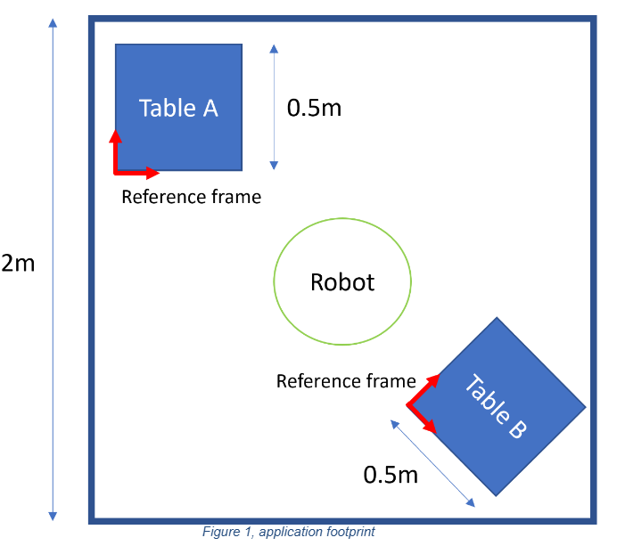

# **Robot Pick & Place Simulation**

## Setup and Run instructions
With having Docker running locally, just run the following to start backend & frontend in Docker.
```
make start
```
Then go to http://localhost:5173/

You can run `make down` to stop the Docker.

If Docker is an issue, you can follow the [Technical Resources](#technical-resources) below, I used the same structure.

## Demo video
<video src="https://github.com/user-attachments/assets/7fd6ea62-f824-4691-a53d-67166815b3e1" controls></video>

## Assumptions

I tried to keep this as simple as possible and really based my decisions from the simple demos in the Vention python libraries' documentation.

I also added a sleep for better frontend display, I thought it would be more accurate for a real robot setting.

There were many things I considered but ultimately didn't implement because they weren't explicitely listed in the requirements:
No custom home position
No custom speed setting
No custom Z clearance value
No tables, cube, robot rotation
No backend logging, errors in frontend should be enough


# Original README:

## **Problem Statement**

You are tasked with building a proof-of-concept for a 3-axis gantry robot solution. The goal is to implement a Python backend that controls a robotic arm using a State Machine and a React frontend to visualize and configure the operation.

You must simulate a "Pick and Place" sequence: picking a cube from **Table A** and placing it on **Table B** within the provided application footprint.



## **Checklist of Requirements**

### **Mandatory Requirements**

**Backend (Python & FastAPI)**

  - [ ] **Communication Framework:** Use the [`vention-communication`](https://pypi.org/project/vention-communication/) library to establish communication between the frontend and backend.
  - [ ] **State Machine Integration:** Implement the robot's control logic using the [`vention-state-machine`](https://pypi.org/project/vention-state-machine/) library.
  - [ ] **Robot Simulation:** Interface with the provided `robot_sim.py` class.
      - *Note:* The `move_to` method must be called repeatedly until motion is complete. This should be handled inside your state machine callbacks.
  - [ ] **API Endpoints:** Create endpoints to:
      - Get/Set robot, cube, and destination positions.
      - specific commands: `Home Robot`, `Start Sequence`, `Get Status`.
      - *Note:* The "Home" operation moves the robot to its home position (default: `[0, 0, 0]`). Review `robot_sim.py` to understand the `move_home()` method and the `home_position` parameter.
  - [ ] **Logic:** Implement the full Pick-and-Place sequence:
    1.  Move to Cube (Table A) $\rightarrow$ Lower $\rightarrow$ Close Gripper.
    2.  Lift $\rightarrow$ Move to Destination (Table B).
    3.  Lower $\rightarrow$ Open Gripper $\rightarrow$ Lift.

**Frontend (React & TypeScript)**

  - [ ] **Dashboard:** Display real-time telemetry:
      - Current Robot Position (X, Y, Z).
      - Cube Start Position & Destination.
      - Robot Status (Gripper open/closed, moving/idle).
      - Current State of the State Machine.
  - [ ] **Controls:** Allow the user to:
      - Configure the Cube's start coordinates and destination coordinates.
      - Trigger the "Home" operation (moves robot to home position, default: `[0, 0, 0]`).
      - Start the "Pick and Place" sequence.
  - [ ] **Visuals:** Provide a clear visual indication of errors and operational state.

### **Bonus Points**

  - [ ] **Persistence:** Use [`vention-storage`](https://pypi.org/project/vention-storage/) to save configuration (e.g., cube locations) between restarts.
  - [ ] **Testing:** Write unit tests for the backend logic or component tests for the frontend.
  - [ ] **Containerization:** Run the whole stack (Backend + Frontend) with a single command (e.g., Docker Compose).
  - [ ] **Demo:** Include a short video recording of your solution in action.

## **Technical Resources**

**Backend Setup**

```bash
cd backend
python -m venv venv
source venv/bin/activate
pip install -r requirements.txt
# Requirements include: fastapi, vention-communication==0.3.0, vention-state-machine==0.3.1, vention-storage==0.5.4
```

**Frontend Setup**

```bash
cd frontend
npm install
npm run dev
```

## **Submission**

  - [ ] Fork the repository and complete the work in your fork.
  - [ ] Include a **README** documenting:
      - Setup and run instructions.
      - Design decisions, assumptions, and trade-offs.
  - [ ] Push your changes and share the repository link.

-----

### **Questions?**

If you have any questions about the exercise, please contact [isaac.mills@vention.cc](mailto:isaac.mills@vention.cc). Happy coding\!
